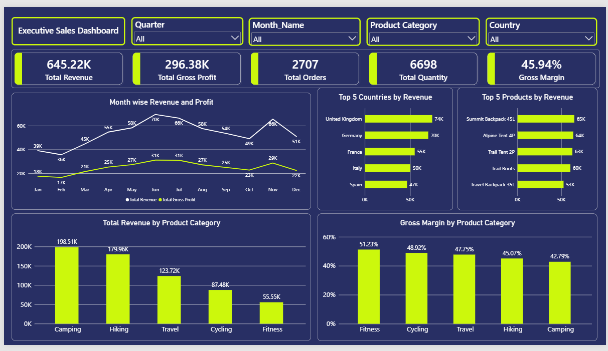

# Executive Sales Dashboard | Power BI

A one-page Power BI dashboard that gives an executive view of sales performance for an outdoor and travel gear business selling across Europe in 2026. It tracks revenue, profit, orders and margin, and breaks them down by month, country, product and product category.



---

## Business Questions

1. How much revenue and gross profit did the business make, and at what margin?
2. How do revenue and profit change month by month?
3. Which countries and products bring in the most revenue?
4. Which product categories are the biggest, and which are the most profitable?

---

## Dataset

**File:** `Sales_Data.xlsx` (sheet: `Data`)

| Item | Detail |
|---|---|
| Rows | 2,707 orders |
| Period | 1 Jan 2026 to 30 Dec 2026 |
| Regions / Countries | 4 regions / 17 countries |
| Product categories | 5 (Camping, Hiking, Travel, Cycling, Fitness) |
| Products | 20 |
| Missing values / duplicate IDs | None found |

**Columns:** ID, Order Date, Region, Country, Sales Channel, Customer Type, Product Category, Product, Units Sold, Unit Price, Discount %, Unit Cost, Revenue, COGS, Gross Profit, Gross Margin %

---

## Dashboard Contents

**Filters (slicers):** Quarter, Month, Product Category, Country

**KPI cards**

| KPI | Value |
|---|---|
| Total Revenue | 645.22K |
| Total Gross Profit | 296.38K |
| Total Orders | 2,707 |
| Total Quantity | 6,698 |
| Gross Margin | 45.94% |

**Charts**

| Chart | Purpose |
|---|---|
| Line chart: Month wise Revenue and Profit | Shows the monthly trend of revenue and gross profit |
| Bar chart: Top 5 Countries by Revenue | Shows where the biggest markets are |
| Bar chart: Top 5 Products by Revenue | Shows the best-selling products |
| Column chart: Total Revenue by Product Category | Shows which categories bring the most revenue |
| Column chart: Gross Margin by Product Category | Shows which categories are the most profitable |

---

## Key Insights

- **Camping is the biggest category but the least profitable.** It brings in 198.5K (about 31% of revenue) but has the lowest gross margin at 42.8%.
- **Fitness is the most profitable but the smallest.** Its margin is the highest at 51.2%, but it brings in only 55.6K (about 9% of revenue). There may be room to grow it.
- **Margin rises as category size falls.** From Camping (42.8%) to Hiking (45.1%), Travel (47.7%), Cycling (48.9%) and Fitness (51.2%), the smaller the category, the higher the margin.
- **Revenue peaks in June (69.5K) and is lowest in February (35.6K).** There is a dip in October (49.1K) followed by a rebound in November (65.5K).
- **Gross profit follows revenue closely.** The profit line moves with the revenue line each month, which suggests a steady margin of about 46%.
- **The UK (74.4K) and Germany (70.0K) lead the market.** Together they make up about 22% of total revenue.
- **Summit Backpack 45L is the top product** at 64.9K, followed closely by Alpine Tent 4P (63.7K) and Trail Tent 2P (62.8K).
- **Online Store is the strongest sales channel**, with about 40% of revenue (260.3K).

---

## Tools and Skills Used

- **Power BI Desktop:** dashboard design, KPI cards, slicers, custom dark theme
- **Power Query:** data loading and cleaning (data types, checks for nulls and duplicates)
- **Data modeling:** `Sales_Data` fact table connected to a `Date_Table` through a one-to-many relationship
- **DAX:** measures for KPIs and margin, with a date table for monthly and quarterly analysis

---

## Key DAX Measures

```DAX
Total Revenue = SUM(Sales_Data[Revenue])

Total Gross Profit = SUM(Sales_Data[Gross Profit])

Total Orders = COUNTROWS(Sales_Data)

Total Quantity = SUM(Sales_Data[Units Sold])

Gross Margin % = DIVIDE([Total Gross Profit], [Total Revenue])
```

---

## Design Choices

- A dark navy background with a single lime accent color (`#CCF80C`) keeps the page consistent and makes the data stand out.
- Titles say exactly what is shown (for example, "Top 5 Countries by Revenue").
- Revenue and profit are on the same axis because both are money values of similar size.
- Months are sorted in calendar order using a month number column.
- Bar charts are used instead of pie charts, since bars are easier to compare.

---

## Files in this Repository

| File | Description |
|---|---|
| `Sales_Dashboard.pbix` | Power BI report file |
| `Sales_Data.xlsx` | Source dataset |
| `dashboard.png` | Dashboard screenshot |
| `README.md` | Project documentation |

**To open:** download `Sales_Dashboard.pbix` and open it in [Power BI Desktop](https://powerbi.microsoft.com/desktop/) (free, Windows only).

---

## Author

**Manas**
Computer Science student | Aspiring Data Analyst

- LinkedIn: https://www.linkedin.com/in/manas-gaikwad-988ba7266/
